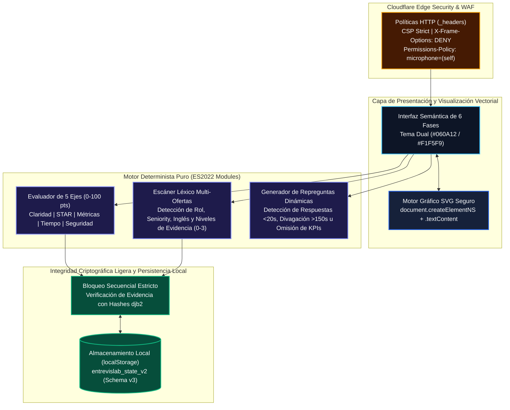
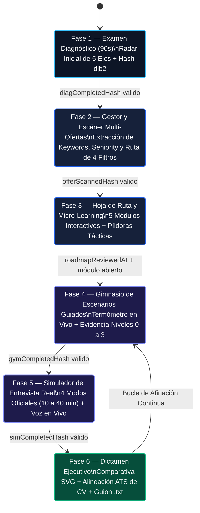
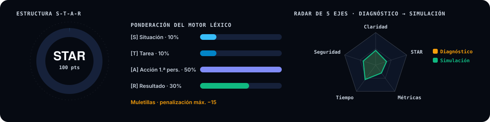

# 🎯 EntrevisLab

  

**Plataforma Web de Entrenamiento Adaptativo End-to-End para Entrevistas Técnicas y Conductuales con Motor Determinista S-T-A-R, Escáner Léxico Multi-Ofertas y Simulador por Voz en Tiempo Real.**

🌐 **[Explorar Demo Interactiva en Vivo (Cloudflare Pages)](https://entrevislab.pages.dev/)**

  

---

## 📌 1. Resumen Ejecutivo

**EntrevisLab** es un sistema de ingeniería *Frontend-Only / Zero-Backend* diseñado para resolver la asimetría entre el conocimiento técnico de un candidato y su capacidad para estructurar evidencia verbal verificable bajo presión temporal durante procesos de selección (*Screening, Assessment Grupal, Entrevista Conductual HR y Entrevista Técnica con Hiring Manager*).

> [!IMPORTANT]
> **Arquitectura de Propiedad Intelectual Protegida (Dual-Repo):** Este repositorio constituye la **Vitrina Técnica Pública (`-showcase`)** diseñada para evaluación de arquitectura, decisiones de ciberseguridad y diseño de sistemas. El código fuente propietario reside en un repositorio privado auditado con commits firmados (`Verified`).

### Indicadores Clave de Ingeniería
- **Cero Dependencias en Producción (`0 npm packages`):** Inmunidad estructural frente a ataques a la cadena de suministro (*Supply Chain Attacks*) y tiempos de carga instantáneos en el Edge.
- **Motor Léxico Determinista Bilingüe (ES/EN):** Evaluación en `< 5 ms` de estructura **S-T-A-R** (*Situación 10%, Tarea 10%, Acción 50%, Resultado 30%*), densidad de métricas contextualizadas, detección de muletillas y verbos de acción en 1.ª persona.
- **Seguridad DOM Estricta (Zero-XSS):** Prohibición total de `.innerHTML`, `.outerHTML`, `document.write()` y `eval()` verificada mediante pruebas SAST automatizadas. Todos los gráficos vectoriales se construyen en tiempo real con `document.createElementNS`.

---

## 🏗️ 2. Arquitectura del Sistema y Flujo de Datos (Paleta *Deep Navy & Metallic Silver*)

---

## 🔄 3. Máquina de Estados de las 6 Fases Secuenciales

  

Cada fase exige evidencia verificable antes de desbloquear la siguiente etapa mediante cadenas de resumen criptográfico ligero (`djb2`), impidiendo la alteración manual de banderas en `localStorage`:

---

## 🧠 4. Ingeniería del Motor Determinista S-T-A-R y Niveles de Evidencia

  

A diferencia de soluciones dependientes de APIs externas con latencia variable, el motor interno de **EntrevisLab** implementa algoritmos deterministas reproducibles:

| Componente Analítico | Lógica de Ingeniería Implementada | Impacto Funcional |
| :--- | :--- | :--- |
| **Normalización Léxica (`NFD`)** | Descomposición Unicode (`normalize('NFD')`) con eliminación de diacríticos y preservación de operadores porcentuales (`%`). | Garantiza paridad exacta de puntuación con o sin tildes y desde transcripciones de voz (`Web Speech API`). |
| **Clasificación de Evidencia (Niveles 0 a 3)** | Evalúa cada competencia de la oferta en cada oración: **Nivel 0** (*Ausente*), **Nivel 1** (*Mencionada*), **Nivel 2** (*Explicada con verbo de acción en 1.ª persona*), **Nivel 3** (*Demostrada con acción + métrica contextualizada*). | Evita que el candidato obtenga puntaje alto solo por listar tecnologías sin demostrar cómo las utilizó ni qué impacto logró. |
| **Filtro Anti-Falsos Positivos de Métricas** | Distingue entre años o números aislados (`bareNumbers`, ej. `"en 2024"`) e indicadores vinculados a verbos de impacto o porcentajes (`contextualMetrics`, ej. `"redujo tiempos un 35%"`). | Impide inflar artificialmente el eje de *Métricas/KPIs* en el Radar de 5 Ejes. |
| **Motor de Repreguntas Dinámicas** | Inspecciona la duración (`< 20s` o `> 150s`), la presencia de verbos en 1.ª persona (`[A]`), métricas (`[R]`) y requisitos de inglés (`B2/C1`) para sintetizar repreguntas adaptadas en tiempo real. | Entrena la capacidad de reacción del candidato ante objeciones reales de un *Hiring Manager*. |

---

## 🛡️ 5. Ciberseguridad (DevSecOps) y Pruebas Automatizadas (SAST)

  

El sistema implementa controles defensivos en profundidad verificados en cada ejecución de pruebas (`node --test`):

1. **Inmunidad contra DOM-XSS:**
   - Auditoría estática automatizada sobre los archivos de interfaz y controladores que verifica `0` ocurrencias de `.innerHTML`, `.outerHTML`, `document.write()` y `eval()`.
   - Pruebas unitarias con inyección de vectores maliciosos (``) confirmando su neutralización total como texto plano.
2. **Protección contra Manipulación de Estado (*State Tampering*):**
   - Si un usuario intenta modificar `localStorage` para desbloquear etapas avanzadas sin evidencia real, el validador recalcula los hashes `djb2` y restablece de forma segura la etapa correspondiente.
3. **Endurecimiento en el Edge (Cloudflare Pages):**
   - Cabeceras HTTP estrictas: `X-Frame-Options: DENY`, `X-Content-Type-Options: nosniff`, `Permissions-Policy: microphone=(self), camera=(), geolocation=(), payment=()` y `Content-Security-Policy` sin orígenes de terceros no autorizados.
4. **Aislamiento en Contenedores Docker:**
   - Imagen `node:20-alpine` configurada con usuario sin privilegios (`USER node`), sistema de archivos de solo lectura (`read_only: true`) y bandera `no-new-privileges:true`.

---

## 🎨 6. Paleta Cromática Oficial (`DESIGN.md`)

| Token Visual | Código Hex | Muestra de Rol en el Sistema |
| :--- | :---: | :--- |
| **Deep Navy Canvas** | `#060A12` | Fondo principal de alto contraste ejecutivo |
| **Elevated Surface** | `#0D1526` | Paneles modulares y tarjetas de telemetría |
| **Executive Royal Blue** | `#2563EB` | Acciones primarias, navegación activa y enfoque |
| **Cyan Context `[S/T]`** | `#38BDF8` | Indicadores de Situación y Tarea (20% de la estructura) |
| **Indigo Action `[A]`** | `#818CF8` | Verbos de Acción en 1.ª Persona (50% de la estructura) |
| **Emerald Result `[R]`** | `#10B981` | Resultados cuantificados (30%), KPIs y estado óptimo |
| **Amber Alert** | `#F59E0B` | Advertencias de muletillas y presión de reloj |

---

## 👤 Autoría y Contacto Profesional

Desarrollado y arquitectado por **Lian Monsalve**.
- 🌐 **Aplicación en Vivo:** [https://entrevislab.pages.dev/](https://entrevislab.pages.dev/)
- 💼 **GitHub:** [@Lian-monsalve](https://github.com/Lian-monsalve)

**Copyright © 2026 Lian Monsalve. Todos los derechos reservados.**
